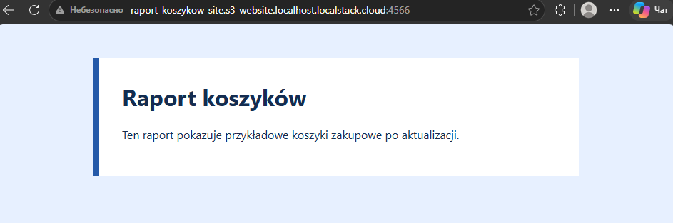
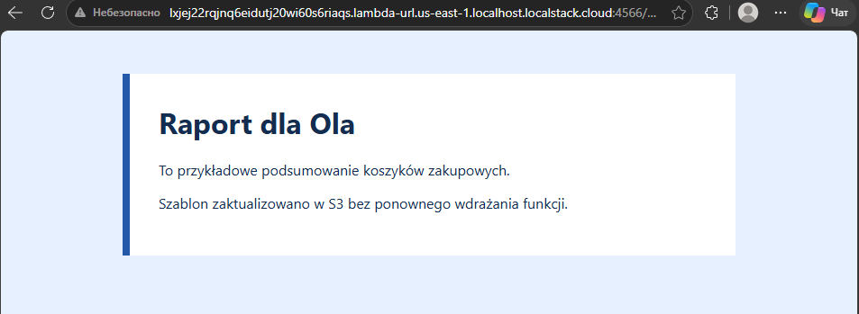
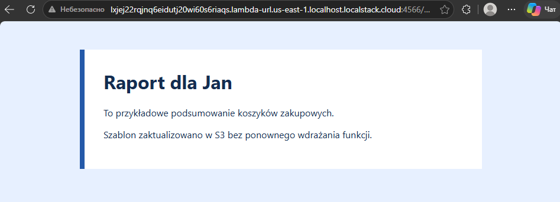

# Lab 2 — S3 Website i Lambda Function URL

Autor: Dmytro Nesvitailo, grupa 2

- Bucket strony: `raport-koszykow-site`
- Prywatny bucket szablonu: `raport-koszykow-template`
- Funkcja Lambda: `raport-koszykow` (Python 3.12)
- LocalStack: 2026.10.6, port `127.0.0.1:4566`

## Uruchomienie i wdrożenie

```powershell
docker compose up -d --wait
docker compose ps

docker compose cp ./www localstack:/tmp/lab2-www
docker compose cp ./bucket-policy.json localstack:/tmp/lab2-bucket-policy.json
docker compose exec -T localstack awslocal s3 mb s3://raport-koszykow-site
docker compose exec -T localstack awslocal s3api put-bucket-policy --bucket raport-koszykow-site --policy file:///tmp/lab2-bucket-policy.json
docker compose exec -T localstack awslocal s3 sync /tmp/lab2-www/ s3://raport-koszykow-site/
docker compose exec -T localstack awslocal s3 website s3://raport-koszykow-site/ --index-document index.html

# Po zmianie zdania w index.html:
docker compose cp ./www/index.html localstack:/tmp/lab2-www/index.html
docker compose exec -T localstack awslocal s3 cp /tmp/lab2-www/index.html s3://raport-koszykow-site/index.html --content-type 'text/html; charset=utf-8'

Compress-Archive -LiteralPath handler.py -DestinationPath lambda.zip -Force
docker compose cp ./template.html localstack:/tmp/lab2-template.html
docker compose cp ./lambda.zip localstack:/tmp/lab2-lambda.zip
docker compose exec -T localstack awslocal s3 mb s3://raport-koszykow-template
docker compose exec -T localstack awslocal s3 cp /tmp/lab2-template.html s3://raport-koszykow-template/template.html
docker compose exec -T localstack awslocal lambda create-function --function-name raport-koszykow --runtime python3.12 --handler handler.handler --role arn:aws:iam::000000000000:role/lambda-role --zip-file fileb:///tmp/lab2-lambda.zip --environment 'Variables={TEMPLATE_BUCKET=raport-koszykow-template,S3_ENDPOINT_URL=http://s3.localhost.localstack.cloud:4566}'
docker compose exec -T localstack awslocal lambda wait function-active-v2 --function-name raport-koszykow
$url = docker compose exec -T localstack awslocal lambda create-function-url-config --function-name raport-koszykow --auth-type NONE --query FunctionUrl --output text
```

Po sprawdzeniu pierwszej wersji dodałem zdanie do `template.html` i podmieniłem obiekt `s3://raport-koszykow-template/template.html`. Identyfikator rewizji funkcji pozostał bez zmian.

```powershell
$object = 'http://127.0.0.1:4566/raport-koszykow-template/template.html'
curl.exe -fsS --aws-sigv4 'aws:amz:us-east-1:s3' --user 'test:test' -T template.html -H 'Content-Type: text/html; charset=utf-8' $object
curl.exe -fsS --aws-sigv4 'aws:amz:us-east-1:s3' --user 'test:test' $object | Select-String -SimpleMatch '{{IMIE}}'
curl.exe -i "$($url.Trim())?imie=Ola"
curl.exe -i "$($url.Trim())"
```

## Zrzuty z przeglądarki

S3 Website: `http://raport-koszykow-site.s3-website.localhost.localstack.cloud:4566/`



Lambda Function URL: `http://lxjej22rqjnq6eidutj20wi60s6riaqs.lambda-url.us-east-1.localhost.localstack.cloud:4566/`





## Odpowiedzi HTTP i źródło HTML

```text
GET /?imie=Ola
HTTP/1.1 200 OK
Content-Type: text/html; charset=utf-8
<h1>Raport dla Ola</h1>
<p>Szablon zaktualizowano w S3 bez ponownego wdrażania funkcji.</p>

GET /
HTTP/1.1 400 BAD REQUEST
Content-Type: text/plain; charset=utf-8
Podaj imię w adresie, na przykład: ?imie=Ola
```

Pusty parametr `?imie=` również zwraca 400. Dla wartości `<b>Ola&Jan</b>` źródło zawierało `&lt;b&gt;Ola&amp;Jan&lt;/b&gt;`, więc przeglądarka wyświetla ją jako tekst.

Fragment obiektu odczytanego z S3 po aktualizacji:

```html
<h1>Raport dla {{IMIE}}</h1>
```

## Wniosek

W wariancie statycznym S3 dostarcza zapisany plik HTML i arkusz CSS. Taka strona wystarcza, gdy każdy użytkownik ma otrzymać tę samą treść. W drugim wariancie Lambda pobiera szablon z S3, wstawia imię z żądania i zwraca wygenerowany HTML. Oddzielenie szablonu od kodu pozwala zmienić treść strony przez podmianę jednego obiektu w S3.
